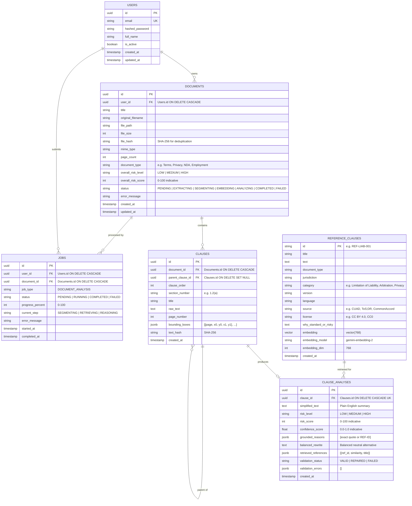

# High-Level Data Model Sketch & API Surface Outline

## 1. High-Level Data Model Sketch

The data model uses PostgreSQL 16 with the `pgvector` extension. All tables enforce strict foreign key constraints, cascading deletes, and tenant isolation via `user_id`.

### Privacy & Data Isolation Guarantees
1. **Cascade Deletion:** `ON DELETE CASCADE` is enforced from `Users` down through `Documents`, `Clauses`, and `ClauseAnalyses`. Calling `DELETE /api/v1/users/me/data` completely purges all user documents, extracted text, and analyses from the database and storage.
2. **Zero-Text Logging:** All log statements across the pipeline record IDs, execution durations, token counts, and hashes—never raw document or clause text.

---

## 2. API Surface Outline

The REST API is versioned under `/api/v1` and returns standard JSON payloads adhering to OpenAPI 3.1 specifications.

### 2.1 Authentication & Profile (`/api/v1/auth`)
- `POST /api/v1/auth/register` — Create new user account (email, password, full_name).
- `POST /api/v1/auth/login` — Authenticate credentials and return JWT bearer token.
- `GET /api/v1/auth/me` — Return current authenticated user profile.

### 2.2 Document Processing & Analysis (`/api/v1/documents`)
- `POST /api/v1/documents/upload`
  - **Input:** Multipart form upload (`file: PDF`, `document_type: string`).
  - **Response:** `202 Accepted` with `{ "document_id": "...", "job_id": "...", "status": "PENDING" }`.
  - **Validation:** Detects corrupt, empty, encrypted, or scanned (<10 chars/page) PDFs and immediately rejects with `400 Bad Request`.
- `GET /api/v1/documents`
  - **Query:** `page`, `page_size`, `status`, `risk_level`.
  - **Response:** Paginated list of user documents with summary risk stats.
- `GET /api/v1/documents/{document_id}`
  - **Response:** Single document metadata, overall risk score, risk level, clause count, and status.
- `GET /api/v1/documents/{document_id}/clauses`
  - **Response:** Ordered list of segmented clauses, their bounding boxes, plain-English simplifications, risk levels, grounded reasons, and balanced rewrites.
- `GET /api/v1/documents/{document_id}/pdf`
  - **Response:** Streams original PDF binary with strict `Content-Disposition: inline` (authenticated user check enforced).
- `DELETE /api/v1/documents/{document_id}`
  - **Response:** `204 No Content`. Cascades and deletes file from disk and database.

### 2.3 Exports (`/api/v1/documents/{document_id}/export`)
- `GET /api/v1/documents/{document_id}/export/json`
  - **Response:** Downloadable structured JSON containing document metadata, risk score, all clauses, risk ratings, grounded citations, and legal disclaimer.
- `GET /api/v1/documents/{document_id}/export/markdown`
  - **Response:** Downloadable formatted Markdown executive briefing with high-risk callouts, clause summaries, and legal disclaimer.

### 2.4 Asynchronous Jobs (`/api/v1/jobs`)
- `GET /api/v1/jobs/{job_id}`
  - **Response:** Real-time job status (`PENDING`, `RUNNING`, `COMPLETED`, `FAILED`), `progress_percent` (0–100), `current_step`, and error logs if failed.

### 2.5 Knowledge Base (`/api/v1/knowledge-base`)
- `GET /api/v1/knowledge-base/clauses`
  - **Query:** `category`, `document_type`, `search_query`.
  - **Response:** Filterable catalog of curated reference clauses and their standard/risky explanations.
- `GET /api/v1/knowledge-base/clauses/{clause_id}`
  - **Response:** Full reference clause text, metadata, source, and standard benchmark description.

### 2.6 User Privacy & Data Deletion (`/api/v1/users/me`)
- `DELETE /api/v1/users/me/data`
  - **Response:** `200 OK` with `{ "deleted_documents": N, "message": "All user data purged successfully." }`.

### 2.7 Health & Readiness (`/api/v1/health`)
- `GET /api/v1/health` — Liveness probe (HTTP 200 `{ "status": "ok" }`).
- `GET /api/v1/health/ready` — Readiness probe (verifies PostgreSQL connection, `pgvector` extension availability, and Redis connectivity).
