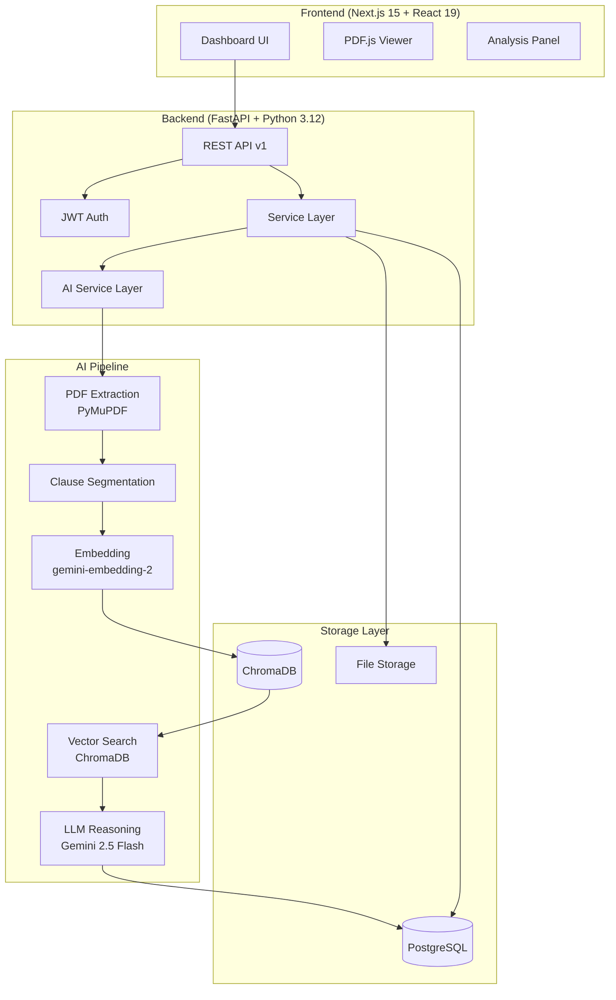
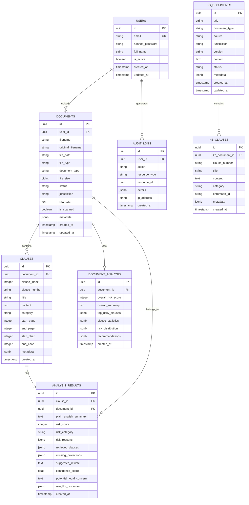

# AI Legal & Policy Document Simplifier with Clause-Level Risk Analysis (RAG)

## Overview

A production-ready, full-stack application that uses Retrieval-Augmented Generation (RAG) to analyze legal documents at the clause level. Users upload legal documents (Terms & Conditions, Privacy Policies, Rental Agreements, Employment Contracts, etc.), and the system extracts, segments, embeds, retrieves reference clauses, and uses Google Gemini to produce structured risk analysis with plain-English explanations.

This plan is organized into **7 sequential phases**. Each phase is self-contained and production-ready before the next begins.

---

## Architecture Overview



---

## Folder Structure

```
project-root/
├── backend/
│   ├── alembic/                    # Database migrations
│   │   ├── versions/
│   │   ├── env.py
│   │   └── alembic.ini
│   ├── app/
│   │   ├── __init__.py
│   │   ├── main.py                 # FastAPI app factory
│   │   ├── config.py               # Pydantic Settings
│   │   ├── dependencies.py         # Dependency injection
│   │   ├── api/
│   │   │   ├── __init__.py
│   │   │   └── v1/
│   │   │       ├── __init__.py
│   │   │       ├── router.py       # Aggregate router
│   │   │       ├── endpoints/
│   │   │       │   ├── auth.py
│   │   │       │   ├── documents.py
│   │   │       │   ├── analysis.py
│   │   │       │   ├── knowledge_base.py
│   │   │       │   ├── export.py
│   │   │       │   └── search.py
│   │   │       └── deps.py         # Route-level deps
│   │   ├── models/                 # SQLAlchemy ORM models
│   │   │   ├── __init__.py
│   │   │   ├── user.py
│   │   │   ├── document.py
│   │   │   ├── clause.py
│   │   │   ├── analysis.py
│   │   │   ├── knowledge_base.py
│   │   │   └── audit_log.py
│   │   ├── schemas/                # Pydantic v2 schemas
│   │   │   ├── __init__.py
│   │   │   ├── auth.py
│   │   │   ├── document.py
│   │   │   ├── clause.py
│   │   │   ├── analysis.py
│   │   │   ├── knowledge_base.py
│   │   │   └── common.py
│   │   ├── services/               # Business logic
│   │   │   ├── __init__.py
│   │   │   ├── auth_service.py
│   │   │   ├── document_service.py
│   │   │   ├── analysis_service.py
│   │   │   ├── knowledge_base_service.py
│   │   │   ├── export_service.py
│   │   │   └── search_service.py
│   │   ├── repositories/           # Data access layer
│   │   │   ├── __init__.py
│   │   │   ├── user_repo.py
│   │   │   ├── document_repo.py
│   │   │   ├── clause_repo.py
│   │   │   ├── analysis_repo.py
│   │   │   └── knowledge_base_repo.py
│   │   ├── ai/                     # AI/ML pipeline
│   │   │   ├── __init__.py
│   │   │   ├── embedding.py        # gemini-embedding-2 client
│   │   │   ├── llm.py              # Gemini 2.5 Flash client
│   │   │   ├── prompts/
│   │   │   │   ├── __init__.py
│   │   │   │   ├── clause_analysis.py
│   │   │   │   ├── risk_assessment.py
│   │   │   │   └── document_summary.py
│   │   │   ├── retrieval.py        # ChromaDB retrieval
│   │   │   ├── pipeline.py         # Orchestrator
│   │   │   └── response_parser.py  # JSON output parsing
│   │   ├── document_processing/    # PDF/DOCX processing
│   │   │   ├── __init__.py
│   │   │   ├── extractor.py        # PyMuPDF text extraction
│   │   │   ├── segmenter.py        # Clause segmentation
│   │   │   ├── ocr_fallback.py     # OCR for scanned PDFs
│   │   │   └── formats.py          # Multi-format support
│   │   ├── core/                   # Core utilities
│   │   │   ├── __init__.py
│   │   │   ├── database.py         # SQLAlchemy engine/session
│   │   │   ├── security.py         # JWT, hashing
│   │   │   ├── exceptions.py       # Custom exceptions
│   │   │   ├── logging.py          # Structured logging
│   │   │   └── rate_limiter.py     # Rate limiting
│   │   └── tasks/                  # Background tasks
│   │       ├── __init__.py
│   │       ├── analysis_task.py
│   │       └── ingestion_task.py
│   ├── cli/                        # CLI commands
│   │   ├── __init__.py
│   │   ├── kb_ingest.py            # Knowledge base ingestion
│   │   └── seed_data.py            # Seed reference clauses
│   ├── knowledge_base/             # Reference clause data
│   │   ├── standard_clauses/
│   │   │   ├── privacy_policy.json
│   │   │   ├── terms_of_service.json
│   │   │   ├── employment_contract.json
│   │   │   ├── rental_agreement.json
│   │   │   ├── loan_agreement.json
│   │   │   └── eula.json
│   │   └── README.md
│   ├── tests/
│   │   ├── conftest.py
│   │   ├── unit/
│   │   ├── integration/
│   │   └── api/
│   ├── uploads/                    # Local file storage
│   ├── requirements.txt
│   ├── Dockerfile
│   ├── .env.example
│   └── pyproject.toml
├── frontend/
│   ├── src/
│   │   ├── app/                    # Next.js App Router
│   │   │   ├── layout.tsx
│   │   │   ├── page.tsx
│   │   │   ├── (auth)/
│   │   │   │   ├── login/
│   │   │   │   └── register/
│   │   │   ├── (dashboard)/
│   │   │   │   ├── layout.tsx
│   │   │   │   ├── upload/
│   │   │   │   ├── documents/
│   │   │   │   ├── analysis/[id]/
│   │   │   │   ├── knowledge-base/
│   │   │   │   ├── history/
│   │   │   │   └── settings/
│   │   │   └── globals.css
│   │   ├── components/
│   │   │   ├── ui/                 # shadcn/ui components
│   │   │   ├── layout/
│   │   │   │   ├── sidebar.tsx
│   │   │   │   ├── header.tsx
│   │   │   │   └── footer.tsx
│   │   │   ├── documents/
│   │   │   │   ├── upload-zone.tsx
│   │   │   │   ├── document-card.tsx
│   │   │   │   └── document-list.tsx
│   │   │   ├── analysis/
│   │   │   │   ├── clause-card.tsx
│   │   │   │   ├── risk-badge.tsx
│   │   │   │   ├── risk-chart.tsx
│   │   │   │   ├── analysis-summary.tsx
│   │   │   │   └── clause-detail-panel.tsx
│   │   │   ├── pdf-viewer/
│   │   │   │   ├── viewer.tsx
│   │   │   │   └── highlight-layer.tsx
│   │   │   └── knowledge-base/
│   │   │       ├── kb-table.tsx
│   │   │       └── kb-upload.tsx
│   │   ├── hooks/
│   │   │   ├── use-documents.ts
│   │   │   ├── use-analysis.ts
│   │   │   ├── use-auth.ts
│   │   │   └── use-search.ts
│   │   ├── lib/
│   │   │   ├── api-client.ts       # Axios/fetch wrapper
│   │   │   ├── utils.ts
│   │   │   └── constants.ts
│   │   ├── types/
│   │   │   ├── document.ts
│   │   │   ├── analysis.ts
│   │   │   ├── auth.ts
│   │   │   └── api.ts
│   │   └── providers/
│   │       ├── query-provider.tsx
│   │       └── auth-provider.tsx
│   ├── public/
│   ├── tailwind.config.ts
│   ├── next.config.ts
│   ├── tsconfig.json
│   ├── package.json
│   └── Dockerfile
├── docker-compose.yml
├── .env.example
├── .gitignore
├── README.md
└── docs/
    ├── architecture.md
    ├── api-reference.md
    ├── deployment.md
    └── developer-guide.md
```

---

## Database Schema (ER Diagram)



---

## Phase Plan

### Phase 1: Project Architecture, Folder Structure, Dependencies, Backend & Frontend Setup, Configuration

**Backend:**
- Initialize Python project with `pyproject.toml`
- Create the full folder structure with `__init__.py` files
- Set up FastAPI app factory with CORS, middleware, exception handlers
- Configure Pydantic Settings (`config.py`) for all environment variables
- Set up structured logging
- Create `.env.example` with all config variables
- Set up `requirements.txt` with all dependencies pinned

**Frontend:**
- Initialize Next.js 15 with App Router, TypeScript, Tailwind CSS
- Install and configure shadcn/ui, TanStack Query, React Hook Form, Zod, Framer Motion
- Create base layout with sidebar, header, theme
- Set up API client, providers, type definitions
- Create placeholder pages for all routes

**Infrastructure:**
- `docker-compose.yml` with PostgreSQL, ChromaDB, backend, frontend
- `.gitignore`, `README.md`
- Dockerfiles for both services

---

### Phase 2: Database, Authentication, File Uploads

**Database:**
- SQLAlchemy 2.0 async models for all tables
- Alembic migrations setup and initial migration
- Repository pattern for data access
- Database session management with dependency injection

**Authentication:**
- JWT access + refresh token flow
- Password hashing with bcrypt
- Login, Register, Refresh endpoints
- Auth middleware and `get_current_user` dependency
- OAuth-ready architecture (provider field on User model)

**File Uploads:**
- Multipart upload endpoint with validation
- File type validation (PDF, DOCX, TXT)
- File size limits (configurable, default 50MB)
- Filename sanitization
- Local storage with abstracted storage interface (S3-ready)

---

### Phase 3: PDF Extraction, Clause Segmentation, Knowledge Base Ingestion

**PDF Extraction:**
- PyMuPDF-based extractor with heading/paragraph/list detection
- Scanned PDF detection (page image ratio heuristic)
- OCR fallback using PyMuPDF's built-in OCR or pytesseract
- Multi-format support: PDF, DOCX (python-docx), TXT, Markdown

**Clause Segmentation:**
- Rule-based segmentation using legal document patterns:
  - Numbered sections (1., 1.1, (a), (i))
  - Legal headings (ALL CAPS, bold detection)
  - Nested clauses and sub-clauses
  - Bullet points and appendices
- Fallback: paragraph-boundary segmentation with minimum length thresholds
- Each clause gets: index, number, title, content, page range, character offsets

**Knowledge Base Ingestion:**
- CLI command: `python -m cli.kb_ingest --source <path> --type <document_type>`
- Process: Extract → Segment → Store in DB
- Support: PDF, DOCX, TXT, JSON, Markdown inputs
- Seed data: pre-built JSON files with standard clauses for 6 document types
- API endpoints for KB management (CRUD)

---

### Phase 4: Embedding Pipeline (gemini-embedding-2), ChromaDB Integration, Retrieval

**Embedding Service:**
- Clean wrapper around Google's `gemini-embedding-2` model
- Batch embedding support (up to 100 texts per API call)
- Retry logic with exponential backoff
- Rate limiting awareness
- Caching layer to avoid re-embedding unchanged clauses

**ChromaDB Integration:**
- Collection management (one per document type, or unified with metadata filtering)
- Metadata schema: clause_id, title, document_type, jurisdiction, category, version, language
- CRUD operations for vectors
- Health check endpoint

**Retrieval Service:**
- Semantic similarity search with configurable Top-K (default K=5)
- Metadata filtering (by document_type, jurisdiction, category)
- Returns: similarity score, original clause text, metadata
- Result ranking and deduplication

---

### Phase 5: Gemini Reasoning Pipeline, Prompt Engineering, Risk Analysis

**LLM Service:**
- Clean wrapper around Gemini 2.5 Flash
- Configurable model selection (swap to Gemini 2.5 Pro)
- Temperature, top_p, max_tokens configuration
- Structured output with JSON mode
- Retry logic and error handling

**Prompt Templates:**
- Clause analysis prompt: takes original clause + retrieved reference clauses → outputs structured analysis
- Document summary prompt: takes all clause analyses → overall assessment
- Clear system instructions with anti-prompt-injection guardrails
- Few-shot examples embedded in prompts

**Risk Analysis Pipeline:**
- For each clause:
  1. Embed clause → Retrieve Top-K references → Build context
  2. Send to Gemini with structured prompt
  3. Parse JSON response into `AnalysisResult`
  4. Validate with Pydantic
- Risk categories: Standard (0-20), Slightly Unusual (21-40), One-sided (41-60), High Risk (61-80), Potentially Unenforceable (81-100)
- Document-level aggregation: weighted risk score, top-10 risky clauses, distribution stats

**Background Processing:**
- Analysis runs as a background task
- Status polling endpoint (`/api/v1/documents/{id}/status`)
- WebSocket or SSE for real-time progress updates

---

### Phase 6: Frontend Dashboard, Interactive PDF Viewer, Clause Analysis Interface

**Dashboard:**
- Document list with status, risk summary, date
- Upload page with drag-and-drop zone
- Analysis page with split view: PDF viewer + clause panel
- Knowledge base management page
- History page with search and filters
- Settings page (API keys, preferences)

**PDF Viewer:**
- PDF.js-based viewer with custom highlight layer
- Color-coded clause overlays (Green/Yellow/Orange/Red based on risk)
- Click-to-navigate: clicking a highlight opens the clause analysis panel
- Zoom, page navigation, search

**Clause Analysis Interface:**
- Scrollable clause list with risk badges
- Expandable clause cards showing:
  - Original text, plain English summary
  - Retrieved reference clauses with similarity scores
  - Risk score, category, reasons
  - Missing protections, suggested rewrite
  - Confidence score
- Risk distribution chart (pie/bar chart)
- Overall document summary panel

**Search:**
- Full-text search across clause titles, content, risk categories, document names
- Debounced search input with real-time filtering

**Export:**
- PDF report generation (using a reporting library or server-side rendering)
- Markdown, JSON, CSV export endpoints

---

### Phase 7: Testing, Optimization, Deployment, Documentation

**Testing:**
- Unit tests: services, AI pipeline, segmenter, embeddings (with mocks)
- Integration tests: API endpoints, database operations
- AI pipeline tests: end-to-end with sample documents
- Retrieval tests: precision/recall metrics on known clause pairs
- Frontend: component tests with React Testing Library

**Optimization:**
- Batch embedding calls to minimize API roundtrips
- Caching: LRU cache for embeddings, Redis-ready interface
- Connection pooling for PostgreSQL
- Lazy loading on frontend

**Deployment:**
- Production Dockerfiles (multi-stage builds)
- `docker-compose.yml` with all services
- Environment variable documentation
- Health check endpoints

**Documentation:**
- README with setup, usage, architecture overview
- Architecture diagram (Mermaid)
- ER diagram (Mermaid)
- API reference (auto-generated from OpenAPI)
- Deployment guide
- Developer guide

---

## User Review Required

> [!IMPORTANT]
> **Database Choice**: The plan uses PostgreSQL as specified. For local development, the Docker Compose setup will include a PostgreSQL container. If you prefer SQLite for simpler local dev (no Docker needed for DB), let me know.

> [!IMPORTANT]
> **Google API Key**: You will need a Google AI API key with access to `gemini-embedding-2` and `gemini-2.5-flash`. This key will be configured via environment variable `GOOGLE_API_KEY`. Please confirm you have this ready.

> [!IMPORTANT]
> **ChromaDB Deployment**: The plan uses ChromaDB in server mode (running as a separate container). An alternative is embedded mode (in-process, simpler but less production-ready). The plan defaults to **server mode** for production readiness. Let me know if you prefer embedded mode for easier local development.

> [!WARNING]
> **Tailwind CSS**: Your requirements specify Tailwind CSS. My default web development guidelines prefer vanilla CSS, but since you explicitly requested Tailwind CSS, I will use it as specified. Please confirm which version — I'll default to **Tailwind CSS v4** (latest with Next.js 15).

## Open Questions

1. **OCR Library**: For scanned PDF OCR fallback, should I use:
   - **pytesseract** (requires Tesseract OCR installed on system) — more accurate
   - **PyMuPDF built-in OCR** (simpler, no extra dependency) — less setup
   - I recommend **pytesseract** for production quality. If unavailable, graceful degradation with a "scanned PDF detected, OCR not available" message.

2. **Real-time Progress**: For document analysis progress, should I implement:
   - **Server-Sent Events (SSE)** — simpler, one-directional, sufficient for progress updates
   - **WebSocket** — bidirectional, more complex but more flexible
   - I recommend **SSE** since we only need server→client progress updates.

3. **Frontend Charts**: For risk distribution visualization, I'll use **Recharts** (lightweight, React-native). Is that acceptable, or do you prefer another charting library?

4. **PDF Report Generation**: For the export-to-PDF feature, I'll use **ReportLab** on the backend. Is that acceptable?

---

## Verification Plan

### Automated Tests
- `pytest` for all backend tests: `cd backend && pytest --cov=app tests/`
- `npm test` for frontend component tests
- API tests via `httpx` test client against FastAPI

### Manual Verification
- Upload a sample Terms of Service PDF and verify end-to-end analysis
- Verify PDF viewer highlights align with extracted clauses
- Verify knowledge base ingestion and retrieval accuracy
- Test all export formats
- Review OpenAPI docs at `/docs`
- Docker Compose full stack startup test
