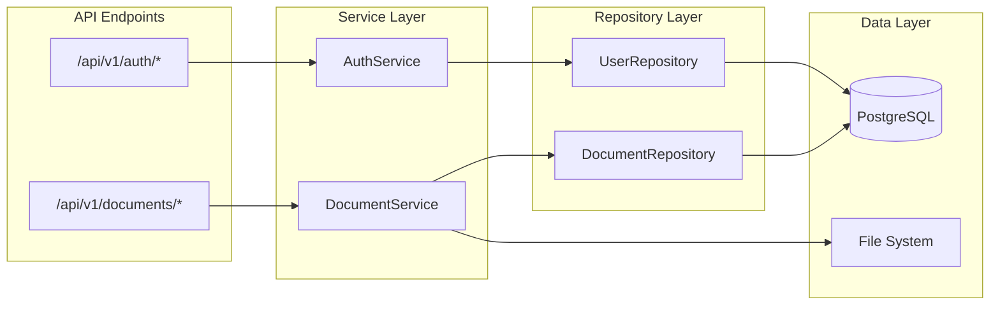

# Phase 2 Walkthrough — Database, Authentication, File Uploads

## Summary

Phase 2 is **complete**. All 8 database tables are modeled as SQLAlchemy ORM classes, the repository pattern provides a clean data access layer, auth and document services implement the business logic, and the API endpoints are fully wired. Alembic is configured for async migrations.

---

## Files Created/Modified

### SQLAlchemy ORM Models (8 tables)

| Model | File | Description |
|-------|------|-------------|
| **User** | [user.py](file:///c:/Users/chinm/Downloads/Legal%20&%20Policy%20Document%20Simplifier%20with%20Clause-Level%20Risk%20Analysis%20(RAG)/backend/app/models/user.py) | `users` — email (unique, indexed), hashed_password, full_name, is_active |
| **Document** | [document.py](file:///c:/Users/chinm/Downloads/Legal%20&%20Policy%20Document%20Simplifier%20with%20Clause-Level%20Risk%20Analysis%20(RAG)/backend/app/models/document.py) | `documents` — file metadata, status tracking, JSONB metadata, FK to users |
| **Clause** | [clause.py](file:///c:/Users/chinm/Downloads/Legal%20&%20Policy%20Document%20Simplifier%20with%20Clause-Level%20Risk%20Analysis%20(RAG)/backend/app/models/clause.py) | `clauses` — extracted clause with page/char offsets, FK to documents |
| **AnalysisResult** | [analysis.py](file:///c:/Users/chinm/Downloads/Legal%20&%20Policy%20Document%20Simplifier%20with%20Clause-Level%20Risk%20Analysis%20(RAG)/backend/app/models/analysis.py) | `analysis_results` — per-clause risk analysis output |
| **DocumentAnalysis** | [analysis.py](file:///c:/Users/chinm/Downloads/Legal%20&%20Policy%20Document%20Simplifier%20with%20Clause-Level%20Risk%20Analysis%20(RAG)/backend/app/models/analysis.py) | `document_analysis` — aggregated document risk assessment |
| **KBDocument** | [knowledge_base.py](file:///c:/Users/chinm/Downloads/Legal%20&%20Policy%20Document%20Simplifier%20with%20Clause-Level%20Risk%20Analysis%20(RAG)/backend/app/models/knowledge_base.py) | `kb_documents` — reference legal documents |
| **KBClause** | [knowledge_base.py](file:///c:/Users/chinm/Downloads/Legal%20&%20Policy%20Document%20Simplifier%20with%20Clause-Level%20Risk%20Analysis%20(RAG)/backend/app/models/knowledge_base.py) | `kb_clauses` — reference clauses with chromadb_id |
| **AuditLog** | [audit_log.py](file:///c:/Users/chinm/Downloads/Legal%20&%20Policy%20Document%20Simplifier%20with%20Clause-Level%20Risk%20Analysis%20(RAG)/backend/app/models/audit_log.py) | `audit_logs` — user action tracking |

---

### Repository Layer

| File | Description |
|------|-------------|
| [base.py](file:///c:/Users/chinm/Downloads/Legal%20&%20Policy%20Document%20Simplifier%20with%20Clause-Level%20Risk%20Analysis%20(RAG)/backend/app/repositories/base.py) | Generic async CRUD: `get_by_id`, `get_all` (paginated), `create`, `update`, `delete` |
| [user_repo.py](file:///c:/Users/chinm/Downloads/Legal%20&%20Policy%20Document%20Simplifier%20with%20Clause-Level%20Risk%20Analysis%20(RAG)/backend/app/repositories/user_repo.py) | `get_by_email`, `email_exists` |
| [document_repo.py](file:///c:/Users/chinm/Downloads/Legal%20&%20Policy%20Document%20Simplifier%20with%20Clause-Level%20Risk%20Analysis%20(RAG)/backend/app/repositories/document_repo.py) | `get_by_user` (paginated + filters), `get_by_id_and_user`, `update_status` |

---

### Services

| File | Description |
|------|-------------|
| [auth_service.py](file:///c:/Users/chinm/Downloads/Legal%20&%20Policy%20Document%20Simplifier%20with%20Clause-Level%20Risk%20Analysis%20(RAG)/backend/app/services/auth_service.py) | `register` → hash + create user; `login` → verify + issue tokens; `refresh` → validate + reissue; `get_profile` |
| [document_service.py](file:///c:/Users/chinm/Downloads/Legal%20&%20Policy%20Document%20Simplifier%20with%20Clause-Level%20Risk%20Analysis%20(RAG)/backend/app/services/document_service.py) | `upload_document` → validate type/size, sanitize filename, save to disk, create DB record; `list_documents`, `get_document`, `delete_document` |

---

### Updated Endpoints

| File | Changes |
|------|---------|
| [auth.py](file:///c:/Users/chinm/Downloads/Legal%20&%20Policy%20Document%20Simplifier%20with%20Clause-Level%20Risk%20Analysis%20(RAG)/backend/app/api/v1/endpoints/auth.py) | All 4 endpoints (`register`, `login`, `refresh`, `me`) now wired to AuthService with DB session injection |
| [documents.py](file:///c:/Users/chinm/Downloads/Legal%20&%20Policy%20Document%20Simplifier%20with%20Clause-Level%20Risk%20Analysis%20(RAG)/backend/app/api/v1/endpoints/documents.py) | All 4 endpoints (`upload`, `list`, `get`, `delete`) now wired to DocumentService with DB session injection |
| [dependencies.py](file:///c:/Users/chinm/Downloads/Legal%20&%20Policy%20Document%20Simplifier%20with%20Clause-Level%20Risk%20Analysis%20(RAG)/backend/app/dependencies.py) | `get_db_session()` async generator for FastAPI Depends() |

---

### Alembic Migration Setup

| File | Description |
|------|-------------|
| [alembic.ini](file:///c:/Users/chinm/Downloads/Legal%20&%20Policy%20Document%20Simplifier%20with%20Clause-Level%20Risk%20Analysis%20(RAG)/backend/alembic.ini) | Alembic configuration (DB URL loaded dynamically from app config) |
| [alembic/env.py](file:///c:/Users/chinm/Downloads/Legal%20&%20Policy%20Document%20Simplifier%20with%20Clause-Level%20Risk%20Analysis%20(RAG)/backend/alembic/env.py) | Async migration environment with asyncpg support |
| [alembic/script.py.mako](file:///c:/Users/chinm/Downloads/Legal%20&%20Policy%20Document%20Simplifier%20with%20Clause-Level%20Risk%20Analysis%20(RAG)/backend/alembic/script.py.mako) | Migration script template |

---

## Architecture Flow

## Next Step: Phase 3

Phase 3 will implement:
1. **PDF text extraction** with PyMuPDF
2. **OCR fallback** with pytesseract for scanned PDFs
3. **Clause segmentation** using legal document patterns
4. **Knowledge base ingestion** CLI + API

Say **"Continue with Phase 3"** to proceed.
